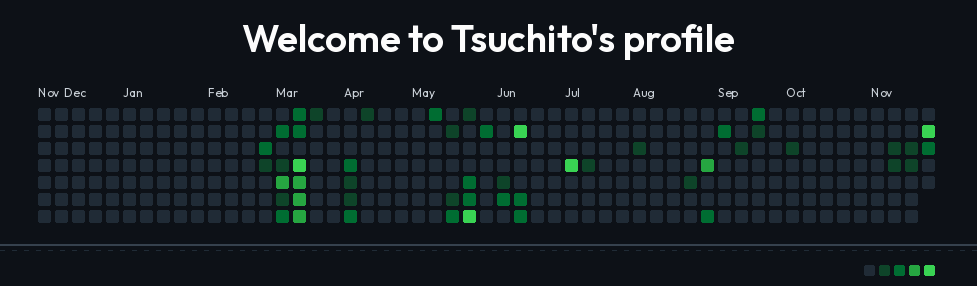

## 👋 My Profile

- 👤 **Name:** tsuchito523
- 🔗 **Links:** [GitHub](https://github.com/tsuchito523)

<!-- 自己紹介・所在地・連絡先などは、公開したい情報だけをここに追加してください。 -->

## 🌟 GitHub Stats

  
  

<!-- 以下の技術アイコンは記事の完成見本を再現したサンプルです。
     実際に使っている技術に合わせて、各URLの i= 以下を編集してください。 -->

## 💻 Programming Languages

## 📚 Library & Framework

## 🌐 Platforms

## 🛠️ Tools

## 💾 Softwares

## 📱 Applications

<!-- 参考: https://zenn.dev/saitogo/articles/93dc53cce42936
     統計カードは GitHub Readme Stats の後継 GitHub Stats Extended を使用。
     トロフィーは公式README掲載のミラーを使用。各画像は外部サービスから取得します。 -->
